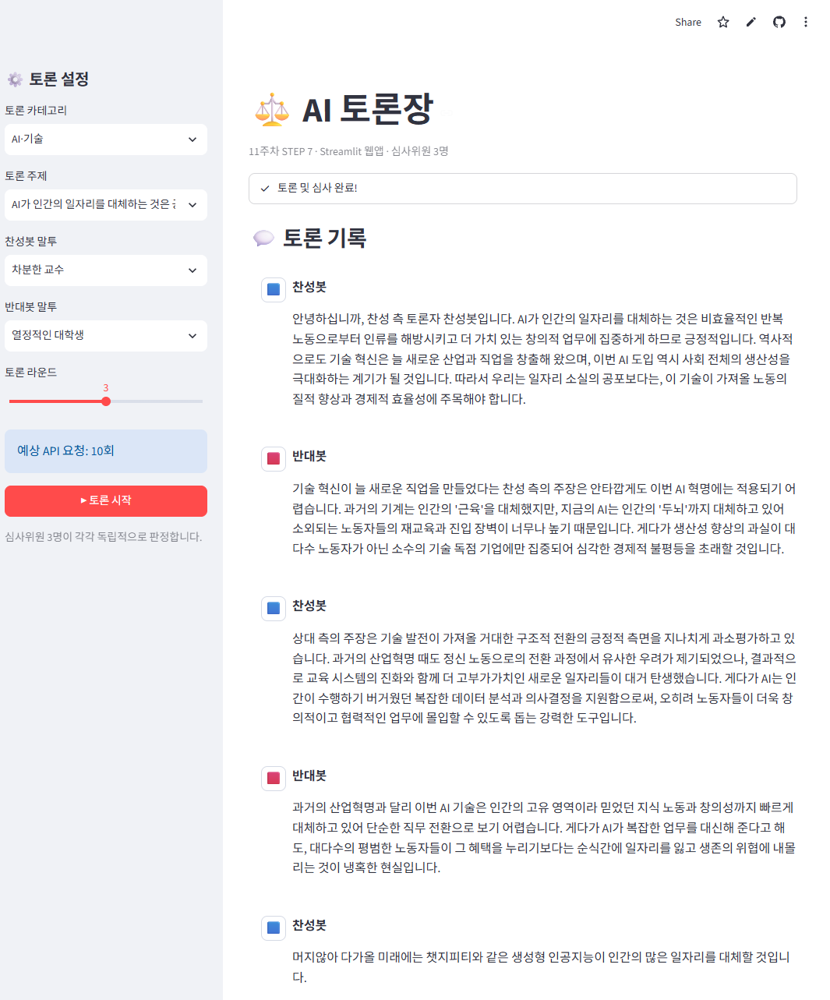
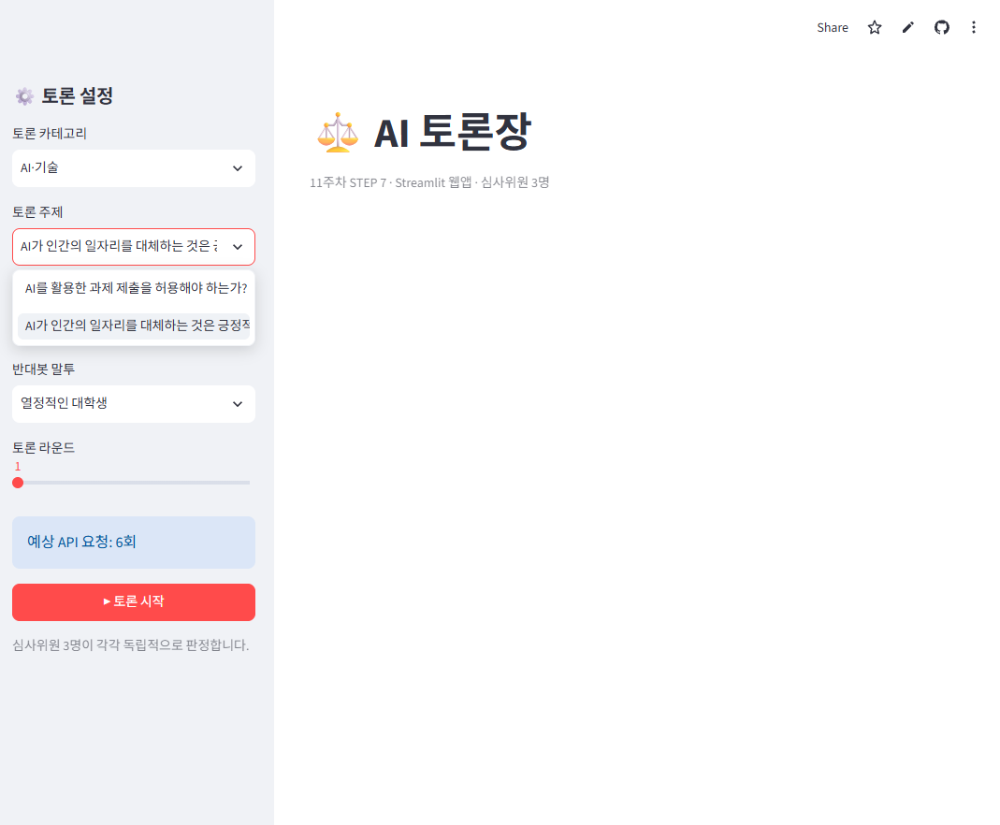
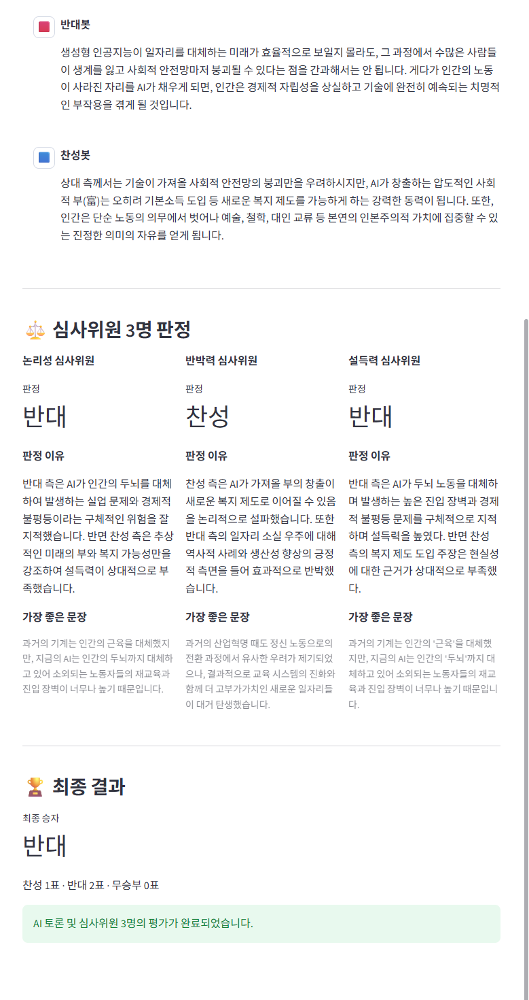

# AI 토론장 — 찬반 토론봇과 심사위원 3명 (Streamlit)

> AI 플랫폼 수업(인공지능 플랫폼실습) 12주차 실습 과제 (개인, 2026.11.04) · 내 역할: **1차 구현(ChatGPT와 함께) · AI가 쓴 코드 검토와 반영 · 배포 · 실제 실행과 결과 확인**
> 11주차에 콘솔로 만든 찬성봇·반대봇 토론을 Streamlit 웹앱으로 옮기고, 심판 1명을 심사위원 3명으로 늘렸다.



## 프로젝트 한 줄

찬성봇과 반대봇(Gemini)이 정해진 라운드만큼 번갈아 반박하고, 기준이 다른 심사위원 3명이 각자 판정한 뒤 다수결로 승자를 정하는 웹앱.

- 코드: [streamlit-lab · 커밋 `dd47cc2`](https://github.com/woosik980201/streamlit-lab/blob/dd47cc2/app.py) (토론장 최종본)
- 배포·제출: Streamlit Community Cloud에 배포하고, 2026-11-04 13:10 웹앱 주소를 과제로 제출했다(최종 커밋 13:04). 같은 저장소를 이후 주차 실습에 계속 써서, 지금 배포 주소에는 다른 실습 화면이 떠 있다. 그래서 실행 링크는 싣지 않는다.

## 판단 과정 한눈에

이 프로젝트에서 보여 주고 싶은 것은 기능의 개수가 아니라 아래 판단이다.

| 단계 | 한 일 | 근거 |
|---|---|---|
| 1. 바꾼 곳은 원본과 대조 | 프롬프트를 함수로 일반화하며 빠진 "존댓말" 조건을 찾아 복원 | 교수님 원본 코드와 함수별 대조 ([사례 1](case-studies.md#사례-1-원본과-한-줄씩-대조하기)) |
| 2. 검증을 둘로 나눔 | 내 코드는 가짜 서버로, 서버와의 호환은 실제 실행 1회로 확인 | 1·3·5라운드 요청 6·10·14회, 429·깨진 JSON 처리 ([사례 2](case-studies.md#사례-2-api-키-없이-먼저-검증하고-마지막은-실제로-돌리기)) |
| 3. 제한을 숫자로 계산 | 요청 수 `1 + 2R + 3`을 화면에 보여 주고, 실제 실행은 한 번에 한 판씩 | 무료 한도 분당 15회 ([사례 3](case-studies.md#사례-3-요청-제한을-숫자로-따지기)) |
| 4. 고칠 범위를 좁힘 | 실제 결과에서 찾은 문제 중 3가지만 수정, 프롬프트로 보장 못 하는 것은 남김 | 실제 토론 결과 읽기 ([사례 4](case-studies.md#사례-4-실제로-돌려-봐야-보이는-문제)) |

## 동작 흐름

```
사이드바 설정 (카테고리 → 주제, 말투 2개, 라운드 R)
        │  토론 시작
        ▼
찬성봇 첫 발언 ──▶ [반대봇 반박 → 찬성봇 재반박] × R
        │  발언 전체를 하나의 기록으로 묶음
        ▼
논리성 · 반박력 · 설득력 심사위원 (각자 따로 호출, JSON으로 답)
        ▼
다수결 → 최종 승자 (최다 득표가 둘 이상이면 무승부)

API 요청 수 = 1 + 2R + 3   →  1라운드 6회 · 3라운드 10회 · 5라운드 14회
```

## 만든 것

| 부분 | 내용 | 왜 |
|---|---|---|
| 토론 진행 | 11주차 `debate_turn()`을 그대로 사용. 찬성봇·반대봇은 각자 자기 대화 기록만 가진다 | 수업에서 만든 핵심 로직을 바꾸지 않고 화면만 바꾸는 과제라서 |
| 프롬프트 | 고정 상수였던 프롬프트를 `build_prompt(입장, 이름, 주제, 말투)` 함수로 일반화 | 사이드바에서 고른 주제·말투를 넣으려면 매번 새로 만들어야 해서 |
| 주제 선택 | AI·기술 / 교육 / 사회 카테고리 → 주제 선택, 또는 `직접 입력` | 입력칸을 따로 두면 "어느 쪽 주제를 쓰나"가 모호해서 한 목록에 넣었다 |
| 심사위원 3명 | 기준만 다른 같은 프롬프트로 3번 호출. 응답은 JSON 스키마(승자 · 이유 · 가장 설득력 있는 문장)로 받는다 | 문장으로 받으면 승자를 코드로 집계할 수 없어서 |
| 다수결 | `Counter`로 표를 세고 최다 득표가 둘 이상이면 무승부 | 1:1:1처럼 승자가 없는 경우도 정해 두려고 |
| 화면 상태 | 토론 기록·판정·실행한 주제를 `st.session_state`에 저장 | Streamlit은 버튼을 누를 때마다 스크립트를 처음부터 다시 실행해서, 저장하지 않으면 결과가 사라진다 |
| 키 관리 | Gemini API 키는 Streamlit Secrets에만 두고 코드에는 넣지 않음 | 공개 저장소에 키가 올라가지 않게 |



## 결과 (실제 Gemini API, 1회)

배포한 앱에서 실제 Gemini API로 실행했다. 주제 선택 기능을 넣은 버전이다.

- 주제 「AI가 인간의 일자리를 대체하는 것은 긍정적인가?」, 3라운드 → 발언 7개(찬성 4 · 반대 3), 심사위원 3명 모두 판정, **반대 2표 · 찬성 1표 → 반대 승**.
- 오류 없이 끝까지 돌았다. 대화 기록을 다음 요청에 넘기는 방식이 실제 서버에서도 받아들여진다는 것을 이 실행으로 확인했다.
- 한계: 1회 실행이라 판정이 얼마나 일관된지는 모른다. 그 뒤 반영한 수정 3건([사례 4](case-studies.md#사례-4-실제로-돌려-봐야-보이는-문제))의 실제 실행 결과는 따로 남기지 않았다.



## 알고 있는 한계 (고치지 않음)

1. 토론 진행 중 사이드바를 건드리면 오류 없이 토론이 중단된다 (Streamlit 재실행 구조 때문).
2. 진행 중에 시작 버튼을 다시 누르면 앞의 요청이 낭비된다.
3. `best_sentence`가 실제 토론 문장과 같은지 검사하지 않는다. 실제로 따옴표 몇 개가 빠진 문장이 나왔다.
4. 모델이 빈 응답을 주면 빈 발언이 그대로 상대에게 넘어간다.

## AI 활용 구분

| 단계 | 누가 |
|---|---|
| 1차 구현 | 나 + ChatGPT |
| 원본 대조 · 가짜 서버 테스트 · 주제 선택과 수정 3건 코드 | Claude가 작성, 내가 검토 후 GitHub에 반영 |
| 배포 · 실제 실행 · 결과 확인 | 나 |

## 작업 기록

- [case-studies.md](case-studies.md) — 문제 해결 사례 5개 (원본 대조, 가짜 서버 검증, 요청 제한 계산, 실제 실행에서 찾은 문제, 배포 문제)
- 커밋 기록: streamlit-lab, 2026-11-04 11:22 첫 버전(`94166ae`) → 13:04 최종본(`dd47cc2`)
- 소스: [streamlit-lab 커밋 `dd47cc2`](https://github.com/woosik980201/streamlit-lab/tree/dd47cc2). 수업 템플릿에서 시작한 코드라 여기에는 사본을 두지 않았다.

## 쓴 도구

Python · Streamlit 1.66 · google-genai 2.12 (Interactions API) · Gemini 3.5 Flash-Lite · Streamlit Community Cloud · GitHub · ChatGPT(1차 구현) · Claude(코드 작성·테스트 보조)
