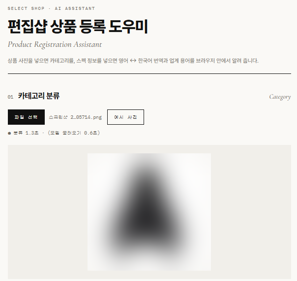
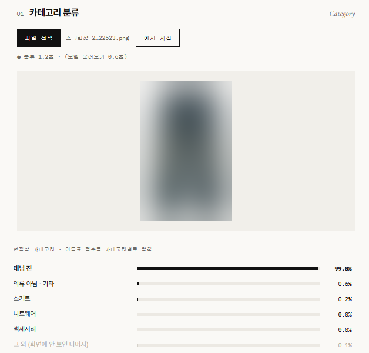
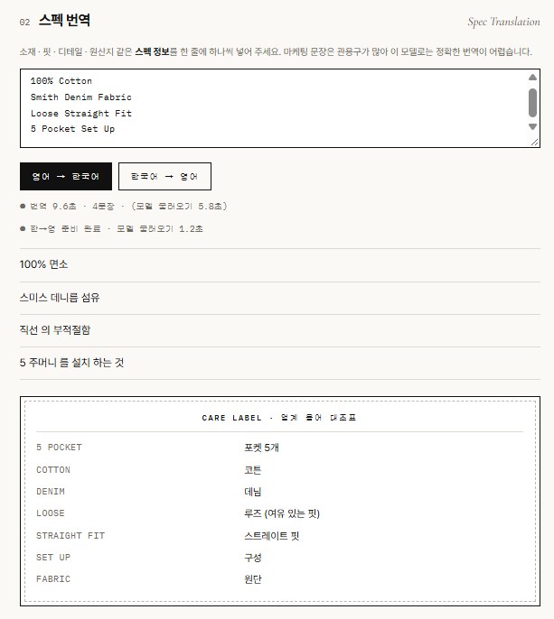

# 편집샵 상품 등록 도우미 — 브라우저 AI 데모

> AI 플랫폼 수업 8주차 개인 중간평가 (1인, 2026.09 말 ~ 10.07 발표) · 내 역할: **문제 정의 · 모델 선정 · 기능 설계 · 테스트와 결과 해석 · 발표**
> 발표 5분(발표 3분 + 질의 2분) + A4 3장 보고서

## 프로젝트 한 줄

수입 상품 사진을 넣으면 **편집샵 카테고리**를, 영문 스펙을 넣으면 **한국어 번역과 업계 용어 대조표**를 보여 주는 브라우저 AI 데모. 서버 없이 HTML 한 파일로, 모든 모델이 방문자의 브라우저에서 실행된다.

- 데모: [huggingface.co/spaces/ws8888/photo_classifier](https://huggingface.co/spaces/ws8888/photo_classifier) · [데모 화면만](https://ws8888-photo-classifier.static.hf.space)

## 왜 만들었나

편집샵에서 일할 때 해외 상품이 들어오면 매번 두 가지를 반복했다. 상품을 매장 카테고리로 분류하는 일, 그리고 영문 택(스펙)을 한국어로 옮겨 적는 일이다. 이 두 반복 작업을 "사진 한 장, 스펙 한 덩어리"로 줄일 수 있는지 확인해 보는 것이 출발점이었다.

## 판단 과정 한눈에

이 프로젝트에서 보여 주고 싶은 것은 기능의 개수가 아니라 아래 세 단계의 판단이다.

| 단계 | 한 일 | 근거 |
|---|---|---|
| 1. 현장 경험으로 문제 정의 | 분류 기준을 ImageNet 이름표가 아니라 **해외 편집샵 카테고리(SSENSE 기준)**로 정함. 번역 방향은 수입 상품 기준 영→한 | 편집샵 근무 경험 |
| 2. 모델의 한계를 숫자로 확인 | 같은 디자인 재킷이 색만 바꿔도 오답에 95.7% 확신. 번역은 업계 용어를 그럴듯하게 틀림 | 직접 찍은 시연 결과 ([사례 3](case-studies.md#사례-3-틀려도-957-확신--점수가-뜻하는-것)) |
| 3. 도메인 지식으로 보완 | 카테고리 합산, 번역 범위를 스펙으로 좁힘, SSENSE 영·한 페이지 대조로 만든 **Care Label 용어 대조표** | SSENSE 영문·한국어 상품 페이지 대조 |

## 만든 것

| 기능 | 만든 것 | 왜 |
|---|---|---|
| 편집샵 카테고리 합산 | ImageNet 이름표 1000개 점수를 전부 받아(`top_k` 5 → 1000) 의류 카테고리(SSENSE 기준) + 신발·가방·액세서리로 묶어 합산. 화면에 안 보인 나머지는 "그 외"로 표시해 합이 100%가 되게 함 | 모델의 이름표는 매장 분류와 다르다. 매장에서 쓰는 단위로 다시 묶어야 쓸 수 있다 |
| 스펙 번역 (영→한) | 줄·마침표 단위로 나눠 한 문장씩 번역. 마케팅 문장은 빼고 스펙 정보만 다룸 | 관용구가 많은 마케팅 문장에서 번역 모델이 특히 약했다 |
| Care Label 용어 대조표 | 번역과 별개로, 영문 스펙에서 업계 용어를 단어 단위로 찾아 업계 표기를 보여 줌. 규칙: "용어는 음차, 색상명은 영어 유지" | 번역 모델이 틀리는 지점(업계 용어)을 도메인 지식으로 메우기 |
| 한→영 번역 | 반대 방향 번역 (보조 기능) | 수업 템플릿의 번역기 틀 유지 |
| UI | 흑백 에디토리얼 + 옷 안쪽 케어 라벨(택) 모티프 | 사용자가 매일 보는 사물에서 화면 언어를 가져옴 |

## 숫자로 본 결과 (직접 찍은 시연, 각 1장)

| 사진 | 이름표 1위 | 카테고리 합산 후 | 판정 |
|---|---|---|---|
| 진청 청바지 | 데님 진 99.0% | — | 정답 |
| 알래스카 맨투맨 | 맨투맨 77.0% | — | 정답 |
| 베이지 재킷 | 맨투맨 39.9% (오답) | **재킷 & 코트 43.8%** (탑 40.0%와 근소한 차이) | 합산으로 정답 |
| 같은 디자인의 검정 재킷 | 맨투맨 95.7% (오답) | 합산으로도 못 고침 | 오답 |

번역에서 실제로 나온 오류:

| 원문 | 번역 결과 | 원인 |
|---|---|---|
| 100% Cotton | 100% 면소 | 반복 억제 옵션의 부작용 ([사례 4](case-studies.md#사례-4-번역-중-페이지가-멈췄다--생성-폭주)) |
| Smith Denim Fabric | 스미스 데니름 섬유 | 업계 용어 (fabric = 원단) |
| Loose Straight Fit | 직선 의 부적절함 | 다의어 (loose · fit) |
| 5 Pocket Set Up | 5 주머니 를 설치 하는 것 | 업계 용어 (set up = 구성) |
| wool (카디건 택) | 솜 | 소재 오류 |

이 결과는 시연용 사진 몇 장과 택 문장 몇 줄로 확인한 것이고, 정확도를 평가한 수치가 아니다.

> 상품 사진은 Alexander Digenova 공식 홈페이지 이미지로 데모를 시험했다. 저작권이 있는 사진이라 공개본에서는 흐리게 처리하거나 뺐다.

## 한계와 다음 단계

**한계**
1. 이름표에 없는 옷(재킷·팬츠 등)은 맞히지 못하고, 틀려도 높은 점수로 확신한다.
2. 번역 모델은 업계 용어와 다의어를 그럴듯하게 지어낸다.
3. 용어집은 문맥을 모르고, 사람이 계속 채워야 한다.

**다음 단계**
- 매장 사진으로 직접 학습(Teachable Machine) 또는 제로샷 분류(CLIP)
- 용어집을 넣은 LLM 번역 (서버 필요)
- 용어집을 코드에서 분리해 직원이 직접 추가
- 영문·한국어 상품 페이지 쌍으로 번역 품질 평가

## AI 활용 구분

| 내가 판단한 부분 | Claude와 함께 작성한 부분 |
|---|---|
| 주제 선정, 번역 방향(영→한), 카테고리 기준(해외 편집샵), 시연 사진 선택, SSENSE 대조로 업계 표기 검증, 테스트와 결과 해석 | 두 템플릿을 합친 코드, 카테고리 합산·용어 매칭 함수, 디자인 CSS, 보고서 슬라이드 |

## 작업 기록

- [case-studies.md](case-studies.md) — 문제 해결 사례 6개 (모델 선정, 합산, 점수의 의미, 생성 폭주, 번역 범위와 용어 대조표, 용어집 오인식)
- 소스: 수업 템플릿을 합쳐 만든 `index.html` 한 파일. 수업 자료 저작권 때문에 여기에는 올리지 않고, 데모 Space에서 실행 화면으로 볼 수 있다.
- 시연 화면: [다른 스펙 번역 예](images/translate-carelabel-2.png)

## 쓴 도구

Hugging Face Static Space · Transformers.js 3.7.6 · Xenova/vit-base-patch16-224 (사진 분류, ImageNet 1000개 이름표) · Xenova/nllb-200-distilled-600M (영→한) · Xenova/opus-mt-ko-en (한→영) · HTML/CSS/JavaScript · Claude(코드 작성·보고서 보조)
