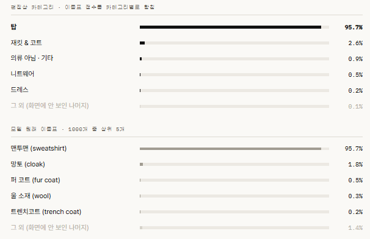
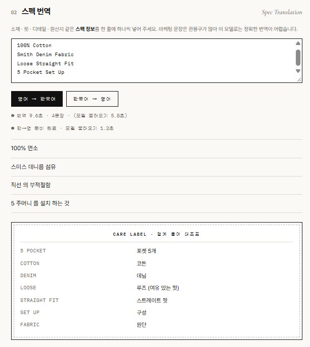

# 문제 해결 사례 — 편집샵 상품 등록 도우미

> 각 사례는 상황 → 고른 것 → 이유 → 결과 → 배운 점. "왜 그렇게 했나"가 핵심이다.

## 사례 1. 원하는 모델보다 "브라우저에서 돌아가는 모델"

- **상황**: 서버 없이 Static Space에 올리려면 모델이 방문자의 브라우저에서 돌아야 했다. 처음에는 패션 전용 분류 모델을 찾았다.
- **조건**: Transformers.js 태그 + ONNX 파일 + 토크나이저 파일, 세 가지가 모두 있어야 쓸 수 있다.
- **결과**: 확인한 패션 분류 모델 5개는 모두 ONNX 파일이 없어 제외. 번역도 4주차에 쓴 opus-mt-tc-big-en-ko의 브라우저 변환본(`noticemkjung/opus-mt-tc-big-en-ko-ONNX`)은 Transformers.js 태그는 있었지만 `tokenizer_config.json`이 없어 "Could not locate file" 오류로 불러오기에 실패했다. 모델 페이지의 파일 목록까지 확인한 뒤 NLLB(nllb-200-distilled-600M)로 교체했다.
- **배운 점**: 모델은 성능보다 먼저 "내 환경에서 실행되는가"로 걸러진다. 오류 메시지가 가리키는 파일을 실제 목록에서 확인하면 원인이 빨리 보인다.

## 사례 2. 모델의 이름표를 매장의 카테고리로 다시 묶기

- **상황**: ViT 모델은 ImageNet 이름표 1000개 중에서 고른다. 매장에서 쓰는 분류(재킷·팬츠·탑…)와 단위가 다르다. 또 상위 5개만 받으니 화면의 확률 합이 100%가 아니었다.
- **고른 것**: `top_k`를 5에서 1000으로 바꿔 모든 이름표 점수를 받고, 해외 편집샵 의류 카테고리(SSENSE 기준) + 신발·가방·액세서리로 묶어 합산했다. 화면에 보이지 않는 나머지는 "그 외" 한 줄로 표시했다. ImageNet에 맞는 이름표가 없는 카테고리(쇼츠 · 액티브웨어 · 점프수트 · 팬츠)는 억지로 채우지 않고 비워 두었다. 대신 그 카테고리는 모델이 절대 고를 수 없다는 점을 코드에 적어 두었다.
- **이유**: 이름표 하나하나는 약해도, 같은 카테고리에 속한 이름표의 점수를 모으면 매장 기준의 판단에 가까워진다. "그 외"를 보여 줘야 숫자가 전체 중 얼마인지 읽힌다.
- **결과**: 베이지 재킷은 이름표 1위가 맨투맨 39.9%(오답)였지만, 합산 후 재킷 & 코트 43.8%로 정답이 됐다. 다만 2위인 탑 40.0%와 차이는 3.8%p로 근소했다.
- **배운 점**: top_k는 "몇 개를 보여 줄까"가 아니라 "몇 개의 점수를 받을까"다. 도메인 기준으로 다시 묶는 것만으로 결과가 바뀔 수 있다.

## 사례 3. 틀려도 95.7% 확신 — 점수가 뜻하는 것

| 베이지 재킷 | 검정 재킷 (같은 디자인) |
|---|---|
| 이름표 1위 맨투맨 39.9% → 합산 후 **재킷 & 코트 43.8%** (정답) | 이름표 1위 **맨투맨 95.7%** → 합산 후에도 탑 95.7% (오답) |

> 상품 사진은 Alexander Digenova 공식 홈페이지 이미지로 데모를 시험했다. 저작권이 있는 사진이라 공개본에서는 흐리게 처리하거나 뺐다.

- **상황**: 베이지 재킷과 같은 디자인의 검정 재킷을 넣었더니 맨투맨 95.7%가 나왔다. 카테고리로 묶어도 고쳐지지 않았다.
- **해석**: 점수는 "정답일 확률"이 아니라 "주어진 보기 중에서 상대적으로 얼마나 비슷한가"다. ImageNet 이름표에는 매장 기준의 '재킷'이 없으니, 모델은 있는 보기 중 가장 가까운 것을 높은 점수로 고른다.
- **결과**: 이 사례를 발표와 보고서에서 한계의 근거로 그대로 보여 줬다. 합산으로 고친 베이지 재킷(사례 2)과 나란히 놓으면, 무엇이 고쳐지고 무엇이 안 고쳐지는지가 보인다.
- **배운 점**: 높은 점수가 정답을 보장하지 않는다. 모델에게 없는 보기는 후처리로 만들 수 없다 → 다음 단계는 매장 사진으로 학습하거나 제로샷(CLIP).

## 사례 4. 번역 중 페이지가 멈췄다 — 생성 폭주

- **상황**: 스펙을 번역하던 중 페이지가 멈췄고, 출력에 "직 직 직"이 약 200번 반복돼 있었다.
- **원인**: 번역 모델이 같은 토큰을 계속 생성하는 폭주.
- **고른 것**: 생성 옵션 세 개로 막았다. `max_new_tokens: 60`(최대 길이), `no_repeat_ngram_size: 3`(같은 토큰 3개 묶음이 다시 나오지 않게), `repetition_penalty: 1.2`(반복에 벌점).
- **확인**: "Loose Straight Fit"으로 비교했다. penalty가 없으면 "직 직 직"으로 다시 폭주했다. `no_repeat_ngram_size`는 같은 묶음이 세 번째 나올 때 멈추게 할 뿐 반복 자체는 막지 못했다. penalty 1.2를 넣으면 "직선 의 부적절함"이 나왔다. 여전히 오역이지만 반복 고리에서는 빠져나왔다.
- **부작용**: "100% Cotton"이 "100% 면소"로 바뀌었다. 반복을 억누르는 옵션이 정상적인 단어 선택에도 영향을 준 것으로 보고, 화면 캡처와 함께 그대로 남겼다.
- **배운 점**: 생성 모델은 "멈추는 조건"을 같이 줘야 한다. 옵션을 넣고 끝내지 않고, 빼 보면서 어떤 옵션이 효과를 내는지 확인했다.

## 사례 5. 번역이 못 하는 부분을 용어 대조표로

- **상황**: 번역 모델은 업계 용어와 다의어에 약했다. Loose Straight Fit → "직선 의 부적절함", 5 Pocket Set Up → "5 주머니 를 설치 하는 것", wool → "솜". 마케팅 문장은 관용구 때문에 더 심했다.
- **고른 것**: ① 번역 범위를 스펙 정보로 좁히고, 줄·마침표 단위로 나눠 한 문장씩 번역했다. ② 번역과 별개로, 영문 스펙에서 업계 용어를 찾아 업계 표기를 보여 주는 **Care Label 용어 대조표**를 만들었다.
- **근거**: SSENSE의 영문·한국어 상품 페이지를 대조해 "용어는 음차, 색상명은 영어 유지"라는 업계 표기 규칙을 찾아 용어집에 반영했다. 택을 넣어 볼 때마다 번역이 틀린 용어는 틀린 번역과 함께 용어집에 적어 두었다(예: fleece → 껍질, crewneck → 크레우닉, print → 인쇄, garment dyed → 옷 염색).
- **결과**: 청바지 스펙에서 번역은 "직선 의 부적절함"으로 틀렸지만, 같은 화면의 대조표에는 LOOSE → 루즈(여유 있는 핏), STRAIGHT FIT → 스트레이트 핏, SET UP → 구성이 나란히 보인다.
- **배운 점**: 모델이 틀리는 지점을 알면, 그 지점만 도메인 지식으로 따로 보여 줄 수 있다. 모델을 고치는 대신 옆에 정답 기준을 세운 것.

## 사례 6. "striped"가 "rib"으로 — 용어집 오인식

- **상황**: 용어 대조표가 striped·ribbon에서 "rib"을, button-down에서 "down"을 찾아냈다.
- **원인**: `includes()`가 단어가 아니라 글자 조각을 찾기 때문.
- **고른 것**: 단어 단위로 비교하도록 바꿨다. 입력을 소문자로 바꾸고 문장 부호를 빈칸으로 바꾼 뒤, 앞뒤에 빈칸을 붙인 `" rib "`처럼 찾는다. 하이픈은 빈칸으로 바꾸지 않아 button-down이 한 단어로 남게 했다. 그 대신 cuff와 cuffs처럼 복수형은 용어집에 따로 적어야 한다.
- **배운 점**: 문자열 검색은 "어디까지가 한 단어인가"를 정해 줘야 한다. 용어집이 커질수록 이런 오인식이 늘어난다 → 용어집은 문맥을 모른다는 한계로 이어진다.
