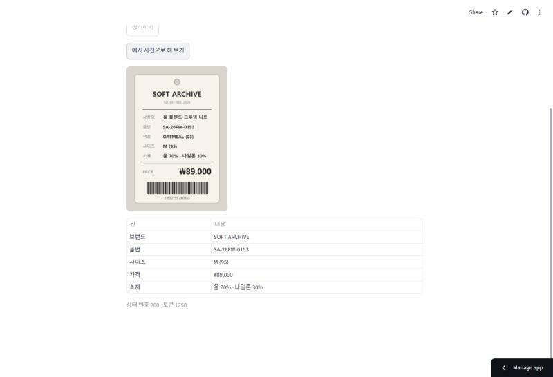
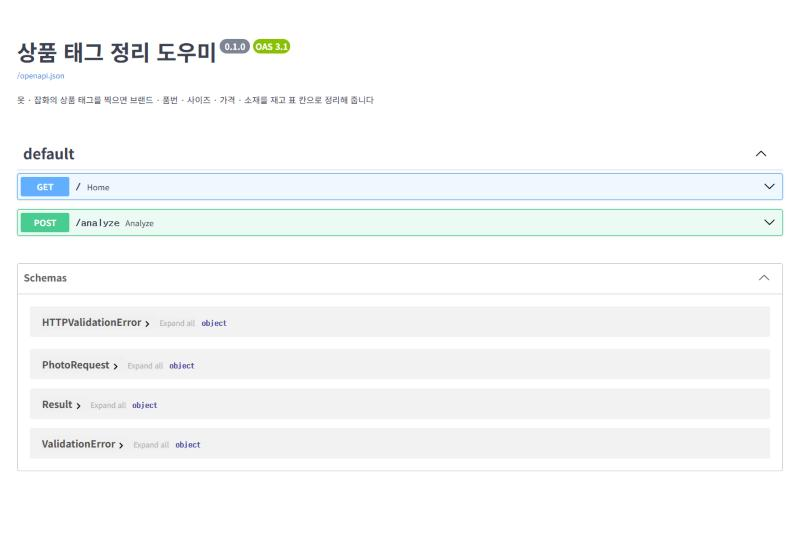

# 상품 태그 정리 도우미 — 사진 한 장으로 재고 표 한 줄 (FastAPI + Streamlit)

> AI 플랫폼 수업(인공지능 플랫폼실습) 14주차 과제 (개인, 2026.11.23) · 멀티모달 AI 웹앱
> 수업 템플릿(백엔드 + 화면)에서 **주제 · 프롬프트 · 결과 칸**을 내 주제로 바꿔 배포한 과제다. 코드 구조는 수업 템플릿 그대로다.



## 프로젝트 한 줄

옷 · 잡화의 상품 태그 사진을 보내면 Gemini가 태그를 읽어 **브랜드 · 품번 · 사이즈 · 가격 · 소재** 다섯 칸(JSON)으로 정리해 주는 웹앱. 백엔드(FastAPI, Vercel)와 화면(Streamlit Community Cloud)을 나눠 배포했다.

- 화면: [woosik-tag.streamlit.app](https://woosik-tag.streamlit.app) · API 문서: [my-api-tag.vercel.app/docs](https://my-api-tag.vercel.app/docs) — 2026-11-23 기준 동작
- 코드: [my-api-tag](https://github.com/woosik980201/my-api-tag) (백엔드) · [my-app-tag](https://github.com/woosik980201/my-app-tag) (화면)

## 왜 이 주제인가

편집샵에서 일할 때 입고 상품의 태그를 보고 재고 표에 손으로 옮겨 적는 일이 반복됐다. 태그 사진 한 장으로 재고 표의 한 줄을 채울 수 있는지 확인해 보는 것이 목표였다.

매장에서 품번을 잘못 조회해 재고를 확인하지 못했고, 그 때문에 판매를 놓친 적이 있다. 품번 한 글자가 틀리면 재고는 "없는 상품"이 된다. 그래서 이 도우미에서는 AI가 그럴듯하게 채운 값보다, 모르는 칸을 비워 두고 사람이 확인하게 하는 쪽을 택했다.

## 바꾼 곳과 이유

과제는 백엔드 `main.py`의 ★ 표시 세 곳만 내 주제로 바꾸는 형식이다. 화면 `app.py`는 예시 사진 이름 한 줄만 바꿨다.

| 바꾼 곳 | 내용 | 왜 |
|---|---|---|
| ① 이름 · 소개 | "상품 태그 정리 도우미" | 화면이 `GET /`로 받아 제목으로 쓴다 |
| ② 프롬프트 | 태그에 **적힌 내용만** 읽게 하고, 없거나 안 보이는 칸은 추측하지 말고 `확인 불가`로 적게 함. 태그가 아닌 사진은 모든 칸에 `상품 태그가 아님` | 재고 데이터는 틀린 값이 빈 값보다 위험하다. 빈 칸은 사람이 채우면 되지만, 그럴듯한 틀린 품번은 그대로 재고 표에 들어가 조회가 안 된다 (위 경험) |
| ③ 결과 칸 5개 | 브랜드 · 품번 · 사이즈 · 가격 · 소재 | 재고 표의 한 줄에 실제로 들어가는 칸. 칸마다 예시(예: `SY-24FW-0153`, `M`, `95`, `FREE`)를 붙여 표기 형식을 맞춤 |
| 예시 사진 | `tag.png` — 코드로 그린 가상 브랜드(SOFT ARCHIVE) 태그 | 실제 브랜드 태그나 개인정보가 담긴 사진을 저장소에 올리지 않으려고 |

## 구조 — 키는 백엔드에만

```
휴대폰 → Streamlit 화면 (woosik-tag)            Secrets: API_URL · APP_ACCESS_CODE
            │  POST /analyze  + 헤더 X-Access-Code
            ▼
         FastAPI 백엔드 (my-api-tag · Vercel)    환경 변수: GEMINI_API_KEY · APP_ACCESS_CODE
            │  사진 + 프롬프트 + JSON 스키마
            ▼
         Gemini 3.5 Flash-Lite → 다섯 칸 JSON
```

- Gemini 키는 Vercel 환경 변수에만 있다. 화면 쪽 코드 · 저장소에는 키가 없다.
- 접근 코드가 틀리면 401로 끝나 Gemini까지 요청이 가지 않는다.



## 결과

| 시험 | 결과 |
|---|---|
| 예시 사진 `tag.png` (가상 브랜드) | 5칸 모두 태그 내용과 일치 — SOFT ARCHIVE · SA-26FW-0153 · M (95) · ₩89,000 · 울 70% · 나일론 30% · 상태 번호 200 · 토큰 1,258 (1회) |
| 휴대폰으로 내 옷의 실제 케어라벨 찍기 (Acne Studios 울 제품, 사진이 옆으로 누운 상태) | 브랜드 `Acne Studios` · 소재 `Wool 100%`는 라벨과 일치. 라벨에 없는 품번 · 사이즈 · 가격은 지어내지 않고 `확인 불가` · 상태 번호 200 · 토큰 1,223 (1회) |

- 실제 사진에서 확인한 것: 사진이 90도 돌아가 있고 글씨가 작아도 브랜드와 소재는 읽었다. 라벨에 없는 세 칸은 비워 두라는 규칙대로 `확인 불가`가 나왔다. 그럴듯한 품번이나 가격을 지어내지 않았다.
- 실제 사진에서 드러난 점:
  - 찍은 것은 가격표가 아니라 **케어라벨**이었다. 프롬프트는 상품 태그가 아니면 모든 칸에 `상품 태그가 아님`을 적게 했지만, 모델은 케어라벨을 상품 태그로 보고 읽었다. 재고 정리에는 오히려 쓸모 있는 동작이지만, "어디까지를 태그로 볼지"를 프롬프트에 정해 두지 않았다는 뜻이다.
  - 소재가 `Wool 100%`로 영어 그대로 나왔다. 칸 설명의 예시는 `면 100%`인데, 라벨에 한국어(`100% 울`)가 함께 있었는데도 영어를 골랐다. 재고 표에 넣으려면 표기 언어를 정해야 한다.
- 한계: 가상 태그 1회 + 실제 케어라벨 1회뿐이다. 가격표 · 품번이 있는 실제 태그는 아직 시험하지 않았다.
- AI가 읽은 값은 틀릴 수 있어서, 재고 표에 넣기 전에 사람이 확인하는 것을 전제로 한다.

## AI 활용 구분

| 단계 | 누가 |
|---|---|
| 주제 선택 (편집샵 재고 · 태그) | 나 |
| 프롬프트 · 결과 칸 · 예시 태그 그림 작성, 저장소 반영과 배포 진행 | Claude (수업에 빠진 날이라 내 PC에서 함께 진행) |
| GitHub · Vercel 권한 승인, 접근 코드 입력, 휴대폰 시험 | 나 |
| 백엔드 · 화면 코드 구조 | 수업 템플릿 |

## 쓴 도구

Python · FastAPI · Pydantic · google-genai (Interactions API, 사진 입력 + JSON 스키마) · Gemini 3.5 Flash-Lite · Vercel · Streamlit Community Cloud · GitHub · Claude
