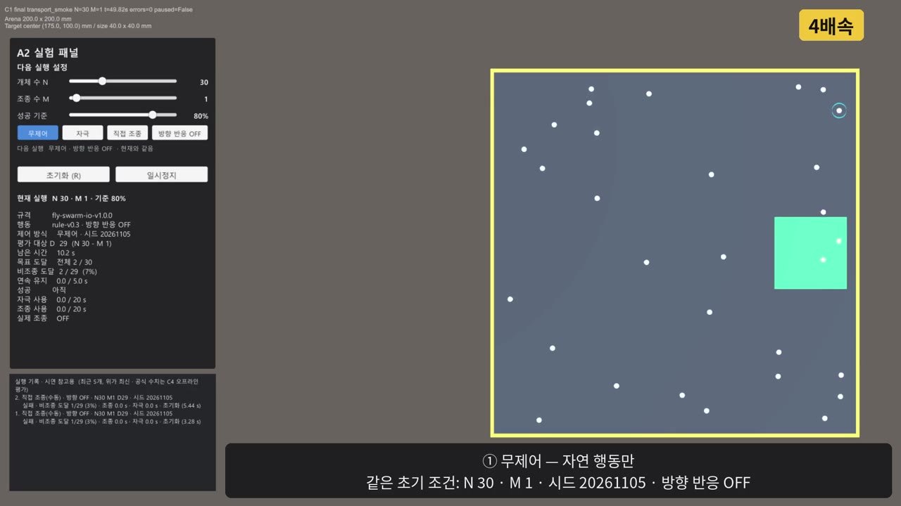
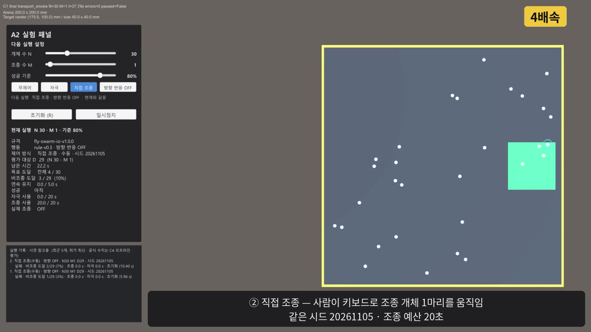
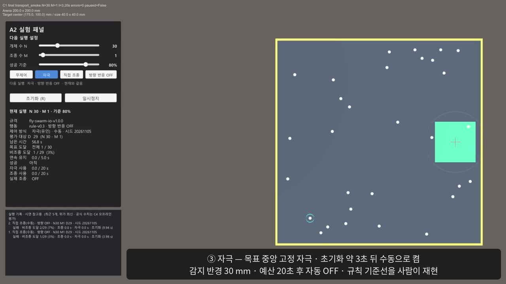

# 초파리 군집 유도 시뮬레이션 — 실험 화면과 통합 (A 파트)

> AI 플랫폼 수업 기말 팀 프로젝트 · 4인 · 2026.11.05 ~ 11.25
> 내 역할: **A 파트 — Unity 실험 화면, 네 파트 통합, 빌드, 성능 측정, 시연 영상**
> 이 폴더에는 내가 맡은 부분만 정리했다. 코드 원본은 팀 저장소에 있고, 다른 파트의 결과물은 싣지 않았다.

## 한눈에 보기

| | |
|---|---|
| 무엇 | 가상 개체 30마리(최대 100)를 목표 구역으로 모으는 방법을 **같은 시작 배치에서 조건만 바꿔** 비교하는 Unity 시뮬레이션. 실제 초파리 실험이 아니라 단순화한 행동 규칙을 가진 가상 개체다 |
| 내가 만든 것 | 실험을 보고 조작하는 화면, 네 파트를 한 씬에서 돌리는 통합, 실행 빌드, 성능 측정 도구, 시연 영상 |
| 규모 | 병합된 PR 6건 · C# 스크립트 9개 약 1,550줄 · 3주 |
| 결과 | 100마리까지 초당 60프레임 유지, 화면을 조작해도 시뮬레이션 결과가 바뀌지 않음을 실행으로 확인 |
| 도구 | Unity 6000.3 · C# · uGUI · Git/GitHub · Linear · ffmpeg · Claude |

## 왜 이 화면이 필요했나

A 파트는 내가 맡겠다고 자원했다. UI와 화면 설계에 관심이 많고, 보기 좋게 다듬는 일에도 흥미가 있어서다.

이 프로젝트의 질문은 "어떤 방법이 무리를 목표로 더 잘 모으는가"다. 답하려면 **조건만 다르고 나머지는 전부 같은** 실행을 나란히 볼 수 있어야 한다. 그런데 화면이 실험에 끼어들면 비교가 무너진다. 버튼을 누른 순간이나 멈춘 시간이 결과를 바꾸면 "방법의 차이"인지 "조작의 차이"인지 알 수 없다.

그래서 화면의 원칙을 하나로 정했다. **화면은 값을 읽어 보여 주고, 다음 실행의 설정만 넘긴다.** 개체를 실제로 움직이는 계산은 한 곳(C 파트의 실행기)에서만 한다.

보여 주는 방식의 기준은 "처음 보는 사람이 지금 무엇이 다른지 바로 읽을 수 있는가"였다. 사람이 조종하는 동안 링 색이 바뀌고, 자극이 닿는 범위를 원으로 그린 것이 그 기준에서 나왔다.

## 팀 안에서 내 자리

| 파트 | 하는 일 |
|---|---|
| **A (나)** | 운동장·목표, 실험 화면, 다른 파트 모듈을 한 씬에 연결, 빌드, 성능 측정, 시연 영상 |
| B | 개체 행동 규칙 |
| C | 시뮬레이션 실행기, 초기화, 제어 입력, 평가 자동화 |
| K | 실험 기준, 학습·평가, 웹 데모, 발표 |

## 만든 것

| 구성 | 기능 | 이렇게 만든 이유 |
|---|---|---|
| 운동장 | 200×200 mm 공간, 40×40 mm 목표. 목표 표시는 실행기의 판정 좌표를 그대로 따름 | 화면의 목표와 실제 판정 목표가 어긋나지 않게 |
| 실험 패널 | 개체 수 N(1~100), 조종 수 M, 성공 기준 슬라이더. 초기화, 일시정지. 남은 시간, 도달 수, 연속 유지, 개입 사용량 | 설정을 바꾸고 같은 조건으로 다시 돌려 보기 |
| 조종 표시 | 조종 후보는 하늘색 링, 실제 조종 중이면 주황 링 | "지금 사람이 개입하고 있는가"가 보이게 |
| 조건 버튼 | 무제어 / 자극 / 직접 조종, 방향 반응 OFF/ON. 고르면 "다음 실행"에 대기하고 초기화 때 적용 | 실행 도중에 조건이 섞이지 않게 |
| 실행 기록 | 실행이 끝날 때마다 조건과 결과를 한 줄씩 기록 | 방금 본 조건별 결과를 나란히 보기 |
| 자극 표시 | 자극 위치와 감지 반경 30 mm 원 | 자극 효과가 작은 이유가 화면에 보이게 |
| 성능 측정 도구 | 실행 인자를 줄 때만 동작, 1초 단위 CSV 기록 | 개체가 늘어도 실시간으로 도는지 숫자로 확인 |

### 구조: 연결 창구 하나

화면 코드 전체가 실행기와 주고받는 곳을 파일 하나(`AExperimentLink`)로 모았다.

| 방향 | 내용 |
|---|---|
| 읽기 | 적용된 설정, 개체 위치와 목표 판정, 성공 여부, 개입 사용량 |
| 쓰기 | 다음 실행의 설정(N, M, 성공 기준, 제어 방식, 방향 반응), 초기화, 일시정지 |

실행 중인 개체의 위치나 속도를 바꾸는 경로는 없다. 그래서 화면을 어떻게 고쳐도 결과는 바뀌지 않고, 실행기 쪽 코드가 바뀌어도 고칠 곳은 이 파일 하나다.

## 어려웠던 점과 해결

자세한 과정은 [case-studies.md](case-studies.md)에 있다.

**① 네 명이 같은 씬 파일을 고칠 때의 충돌.** 내 코드는 한 폴더에만 두고 다른 파트 파일은 담당자에게 요청했다. 빌드 설정도 공유 파일이라 전용 빌드 프로필을 따로 만들었다. 수정은 기능 단위 PR 6개로 나눴다.

**② 화면이 어디까지 해도 되는지 정하기.** 이슈 설명에는 "UI에서 개체 생성"까지 적혀 있었지만 팀 원칙과 맞지 않았다. 코드를 쓰기 전에 읽을 값과 쓸 값을 번호 붙인 질문으로 확인했고, 답으로 받은 API가 실제 코드에 있는지 하나씩 대조했다. 이름만 보고 "일시정지"라고 짐작한 값이 실제로는 "실행 중 아님"이었다.

**③ 버튼 키와 조종 키가 겹침.** Unity UI는 방향키와 Space로 버튼을 조작하는데 이 키가 개체 조종 키와 같았다. 초기화 버튼을 누른 뒤 Space로 조종을 켜면 실험이 다시 초기화될 수 있었다. 버튼의 키보드 이동을 끄고 클릭 후 선택을 해제했다.

**④ "화면이 결과를 바꾸지 않는다"를 확인하기.** 같은 시작 배치로 그냥 실행한 것과 5초 멈췄다 재개한 것을 비교했다. 같은 시점의 30마리 배치가 같았다.

**⑤ 자극을 켰는데 변화가 안 보임.** 고장이 아니었다. 개체는 자극에서 30 mm 안에 있을 때만 반응하는데 기본 위치가 목표 중앙이라 근처 개체만 반응한다. 기능을 바꾸지 않고 자극 위치와 감지 반경을 화면에 그렸다.

**⑥ 실행 기록에서 마지막 결과가 빠짐 (코드 리뷰에서 지적받음).** 기록이 "마지막으로 화면에 그린 값"을 적고 있어서, 마지막 순간의 결과가 빠지거나 59.9초에 초기화한 실행이 "60초 종료"로 적힐 수 있었다. 교체된 실행기는 마지막 상태로 멈춰 있으므로 그것을 직접 읽게 고쳤다. 사람이 0.1초 안에 버튼을 누를 수는 없어서, 끝나기 직전에 초기화를 대신 눌러 주는 확인 메뉴를 만들어 재현했다.

## 검증과 성능

**성능.** 학교 PC(Xeon W-2223 · RTX 3080), 비개발 빌드, 1920×1080 전체 화면, 시작 후 5초를 뺀 60초.

| 행동 규칙 | 개체 수 | 평균 FPS | 1초 최저 | 계산 스텝/초 |
|---|---|---|---|---|
| rule-v0.2 | 30 / 50 / 100 | 60.0 | 59.9 / 59.7 / 59.9 | 50.0 |
| rule-v0.3, 방향 반응 OFF | 30 / 100 | 60.0 | 60.0 / 59.9 | 50.0 |
| rule-v0.3, 방향 반응 ON | 30 / 100 | 60.0 | 59.9 / 59.9 | 50.0 |

목표였던 30 FPS를 모든 조건에서 넘었고, 0.02초 단위 계산을 실제 시간과 같은 속도로 처리했다.

읽을 때 주의할 점: 60 FPS는 모니터 동기화 상한이라 실제 여유가 얼마인지는 재지 않았다. 조건마다 한 번씩만 쟀다. 고사양 PC 기준이다. 50마리는 rule-v0.2로만 쟀다.

**같은 시작 배치 비교 (시연 참고용, 각 1회).** 30마리 중 1마리 조종, 같은 시드.

| 조건 | 60초 안에 목표에 도달한 비조종 개체 |
|---|---|
| 무제어 | 2 / 29 |
| 직접 조종 (사람이 조작, 20초) | 5 / 29 |
| 목표 중앙 고정 자극 (20초) | 0 / 29 |

사람이 조작한 1회 결과라 설명용이다. 팀의 공식 비교는 C 파트의 자동 평가(같은 시드 30개 반복)를 쓴다.

## 시연 영상

실시간 시연이 막힐 때를 대비해 찍었다. 전체판 2분 43초, 짧은 판 1분 40초. 아래는 같은 시작 배치의 세 조건 장면이다.

| ① 무제어 | ② 직접 조종 | ③ 자극 |
|---|---|---|
|  |  |  |

- 수정 전 빌드로 찍은 리허설본은 버리고 전부 다시 찍었다. 영상 전체가 같은 빌드여야 하기 때문이다.
- 사람이 타이밍을 고른 장면은 "설명용"이라고 자막에 적었다.

## 넣지 않은 것

결과를 한눈에 읽게 하는 화면 개선(도달률 막대와 5초 연속 유지 링)을 제안했고, 승인 전이라 별도 브랜치에 읽기 전용으로 만들어 동작까지 확인했다. 발표 전날 팀 결정으로 넣지 않았다. 별도 브랜치였기 때문에 되돌릴 것이 없었다.

제안 자료: [현재 화면](images/proposal-1-current.png) · [개선안 목업](images/proposal-2-mockup.png) · [요약표](images/proposal-3-summary.png) · [개체 모양 후보](images/proposal-4-fly-shapes.png)

## 배운 점

3주 동안 가장 흥미로웠던 것은 일하는 방식이었다. 네 명이 각자 자리에서 맡은 부분을 만들어 커밋하고, 서로에게 확인을 요청하고, 확인을 받아야 합쳐진다. 내 확인이 늦으면 다른 사람의 일이 멈춘다는 것을 알고 나니 책임감이 생겼고, 리뷰 요청이 오면 최대한 빨리 내 PC에서 직접 돌려 보고 답하려고 했다. 그게 부담이 아니라 하고 싶은 일로 느껴졌다.

- 첫 일은 코딩이 아니라 기준을 정하는 것이었다. 기획서, 규격, 받은 코드가 서로 달랐고, 우선순위를 먼저 정해 두니 이후에 "어느 쪽이 맞는가"로 시간을 쓰지 않았다.
- "영향 없다"는 말보다 같은 조건으로 한 번 비교한 결과가 설득력이 있었다.
- 좋은 숫자일수록 측정 조건과 한계를 같이 적어야 질문에 답할 수 있었다.
- 기능이 안 보일 때는 기능을 바꾸기 전에 먼저 보이게 만드는 쪽이 맞았다.

**다음에 다르게 할 것.** 단계가 끝날 때마다 깨끗한 캡처와 측정 조건을 바로 남긴다. 화면 개선 제안은 기능 마감 전에 목업으로 먼저 공유한다.

## AI를 어떻게 썼나

Claude로 코드 초안, 원격 빌드와 측정 실행, 문서와 자막 정리를 했다. 무엇을 만들지와 범위 결정, 팀원과의 합의, 키보드 조작 확인과 영상 촬영은 내가 했고, 결과는 Unity 실행으로 직접 확인했다.

## 더 보기

- [devlog.md](devlog.md) — 날짜별 작업 기록 (11/05 ~ 11/24)
- [case-studies.md](case-studies.md) — 문제 해결 사례 11개
