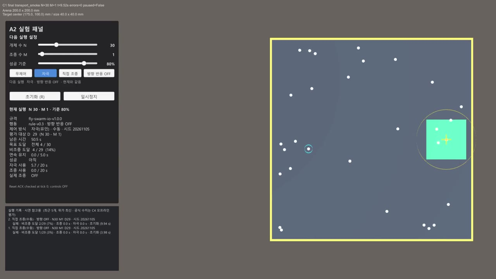
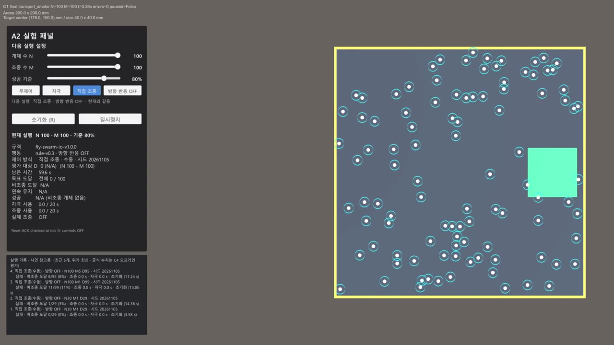

# 초파리 군집 유도 시뮬레이션 — A파트 (Unity·UI·통합)

> AI 플랫폼 수업 기말 팀 프로젝트 (4인, 2026.11) · 내 역할: **A파트 — Unity 공간·UI·씬 통합·빌드·시연 영상**
> 이 폴더는 내가 맡은 부분만 정리한 작업 기록이다. 코드 원본은 팀 저장소에 있다.

## 프로젝트 한 줄

가상 개체 30마리(최대 100)를 200×200 mm 공간의 목표 구역으로 유도하는 방법(무제어 · 직접 조종 · 유인 자극 · 규칙 · 학습)을 **같은 초기 조건에서 비교**하는 Unity 시뮬레이션. 실제 초파리 실험이 아니라, 단순화된 행동 규칙을 가진 가상 개체 모델이다.

## 팀 안에서 내 자리

| 파트 | 하는 일 |
|---|---|
| **A (나)** | 3D 공간·경계·목표, 화면 UI, 다른 파트 모듈을 한 씬에 연결, 실행 빌드, 성능 측정, 시연 영상 |
| B | 개체 행동 규칙 |
| C | 시뮬레이션 실행기·Reset·제어 입력·평가 자동화 |
| K | 실험 기준·학습·평가·발표 |

원칙: 개체의 실제 이동은 C의 실행기 하나만 계산한다. A 화면은 **값을 읽어 보여 주고, 다음 실행 설정만 넘긴다.** 그래서 UI를 아무리 바꿔도 시뮬레이션 결과는 바뀌지 않는다.

## 내가 만든 것

| 단계 | 만든 것 | 왜 | 팀 저장소 |
|---|---|---|---|
| A1 공간 | 200×200 mm 경기장·경계·목표, 카메라, mm 표시. 목표 표시가 실행기 판정 좌표를 그대로 따라감 | 화면에 보이는 목표와 실제 판정 목표가 어긋나지 않게 | PR #1 |
| A2 실험 패널 | 개체 수 N·조종 수 M·성공 기준 슬라이더, 초기화, 현재 실행 지표, 조종 후보 링 | 설정을 바꾸고 같은 조건으로 다시 돌려 보는 실험 화면 | PR #2 |
| A2 후속 | 일시정지/재개, 실제 조종 표시(하늘색 → 주황), 패널 배치 정리 | 시연 중 멈추고 설명할 수 있게, "지금 실제로 조종 중인지"가 보이게 | PR #12 |
| A3 통합 | 행동 규칙(B) 프로필을 A 씬에 연결, rule-v0.3 전환 | 세 파트 결과물을 한 화면에서 돌아가게 | PR #6, #13 |
| A4 비교 화면 | 제어 방식 버튼(무제어/자극/직접 조종), 방향 반응 OFF/ON, "다음 실행" 대기 표시, 실행 기록 표, 자극 위치·감지 반경 표시 | 같은 시드에서 조건만 바꿔 결과를 나란히 보기 | PR #16 |
| A4 성능 | 측정 도구(명령줄 인자로만 동작), N=30·50·100 × 방향 반응 OFF/ON 측정 | 개체가 늘어도 실시간으로 도는지 숫자로 확인 | PR #16 |
| A5 영상 | 같은 시드 비교 시연 영상(2:43)과 짧은 판(1:40), 자막. 팀 피드백으로 v2 | 실시간 시연이 실패해도 보여 줄 수 있게 | — |
| 화면 개선 (미반영) | 비조종 도달률 막대(80% 기준선) + 5초 연속 유지 링. 구현·확인했지만 발표 전 팀 결정으로 넣지 않음 | 결과를 한눈에 읽게 | 로컬 브랜치 |
| 발표 (11/25) | 내 파트 슬라이드 3~5 검토·수정안, 대본 | 맡은 부분을 직접 설명 | — |

## 숫자로 본 결과 (내가 측정·촬영한 것)

- **성능**: 학교 PC(Xeon W-2223 · RTX 3080), 1920×1080, vSync 60 Hz. N=30·50·100, 방향 반응 OFF·ON 모든 조건에서 평균 60 FPS, 초당 50스텝(실시간 1.0배). 한계: vSync 상한에 붙은 값이라 실제 여유는 측정하지 않았고, 조건마다 1회 측정.
- **같은 시드 비교 (시연 참고용, 각 1회)**: 무제어 2/29 · 직접 조종 5/29 · 목표 중앙 고정 자극 0/29가 60초 안에 목표에 도달. 공식 비교 수치는 팀의 오프라인 평가 결과를 쓴다.

## 작업 기록

- [devlog.md](devlog.md) — 날짜별 작업 기록 (11/05 ~ 11/24)
- [case-studies.md](case-studies.md) — 문제 해결 사례
- 11/23 팀 회의용 화면 개선안: [현재 화면](images/proposal-1-current.png) · [개선안 목업](images/proposal-2-mockup.png) · [요약표](images/proposal-3-summary.png) · [개체 모양 후보](images/proposal-4-fly-shapes.png)

## 쓴 도구

Unity 6000.3 · C# · uGUI · ML-Agents 4.1 (팀 공통) · Git/GitHub Desktop · Linear · ffmpeg(영상 편집) · Claude(코드 작성·검증·문서화 보조)
