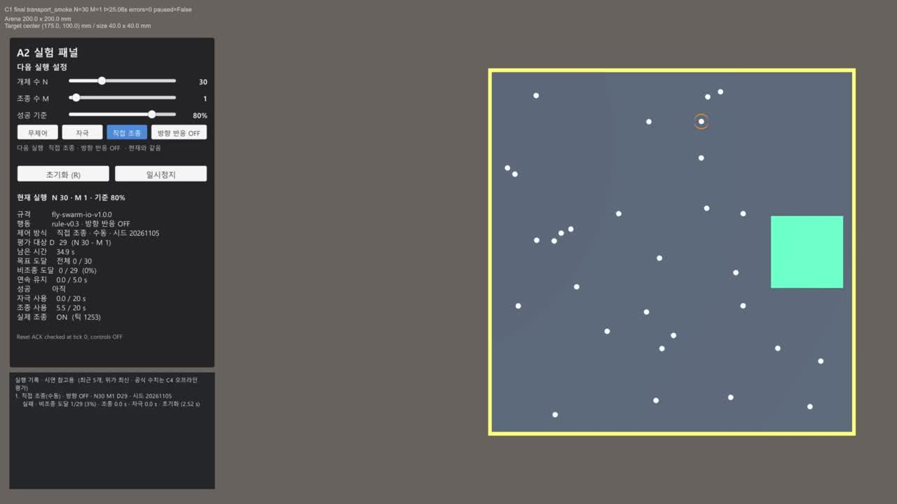

# 문제 해결 사례 — A파트

> 각 사례는 상황 → 고른 것 → 이유 → 결과 → 배운 점. "왜 그렇게 했나"가 핵심이다.

## 케이스 1. 기준부터 세우고 원본은 건드리지 않기 (11/05–11/06)

- **상황**: 기획서, 팀 공통 규격, 받은 코드가 서로 달랐다(예: 개체 구성이 "29+1마리 고정"에서 "가변 N·M"으로 바뀜).
- **고른 것**: 정보 우선순위를 먼저 정하고 현황·계약·검증 문서를 만들었다. 받은 프로젝트는 수정 없이 실행해 기준선을 남기고, 내 씬은 복사본에서 시작했다.
- **이유**: 기준이 여럿이면 "누구 말이 맞나"로 시간을 쓴다. 원본이 남아 있으면 문제가 생겼을 때 내 변경 때문인지 비교할 수 있다.
- **배운 점**: 팀 프로젝트의 첫 일은 코딩이 아니라 "무엇이 진실인가"를 정하는 것.

## 케이스 2. 공유 설정을 건드리지 않고 빌드하기 (11/10)

- **상황**: 빌드 씬 목록은 팀 공유 파일이라, 내 씬을 넣으면 다른 사람 빌드가 바뀐다.
- **고른 것**: Unity 6의 Build Profile로 A 전용 씬 목록을 따로 만들었다.
- **결과**: 첫 빌드 성공, 공유 설정 변경 0. 이후 모든 A 빌드(성능 측정·영상)에 재사용.
- **배운 점**: "임시로 바꿨다 되돌리기"는 잊어버린다. 내 영역 안에서 푸는 방법을 먼저 찾는다.

## 케이스 3. 코드 전에 접점부터 합의하기 (11/10)

- **상황**: 업무 설명에는 "UI에서 개체 생성·조종 개체 선택"까지 적혀 있었지만, 팀 원칙은 "개체를 바꾸는 곳은 실행기 하나"였다.
- **고른 것**: 충돌을 먼저 알리고, C 담당에게 번호 붙인 질문으로 읽을 값·쓸 값을 물었다. 답으로 받은 API는 실제 코드에 있는지 하나씩 대조했다.
- **발견**: 화면의 `paused`는 "일시정지"가 아니라 "실행 중 아님"이었다. 이름만 보고 추측한 것을 코드로 정정.
- **결과**: UI 범위가 "설정 전달 + 화면 표시"로 확정. UI를 아무리 바꿔도 결과가 바뀌지 않는 구조가 여기서 나왔다.
- **배운 점**: 상대가 말한 API도 코드에서 확인한다.

## 케이스 4. 설계 단계에서 잡은 키보드 충돌 (11/10)

- **상황**: Unity UI는 방향키·Space로 버튼을 조작하는데, 이 키가 개체 조종 키와 같았다. 초기화 버튼을 누른 뒤 Space로 조종을 켜면 실험이 리셋될 수 있었다.
- **고른 것**: 버튼·슬라이더의 키보드 이동(Navigation)을 끄고, 클릭이 끝나면 선택을 해제했다. 테스트 항목에도 넣었다.
- **배운 점**: 설계 단계에서 찾은 버그가 가장 싸다.

## 케이스 5. UI가 결과를 바꾸지 않는다는 걸 증명하기 (11/16)

- **상황**: 일시정지 버튼을 넣으면 "멈췄다 재개하면 결과가 달라지지 않나?"라는 의문이 생긴다.
- **고른 것**: 같은 시드로 "그냥 실행"과 "5초 멈췄다 재개"를 돌려, 남은 시간 49.8초 시점의 30마리 배치를 비교했다.
- **결과**: 배치 동일. 일시정지는 결정·이동 단계를 통째로 건너뛰기 때문.
- **배운 점**: "영향 없다"는 말보다 같은 조건 비교 한 번이 설득력 있다.

## 케이스 6. 성능은 숫자와 한계를 같이 (11/19, 11/22)

- **상황**: "개체 100마리에서도 실시간으로 도나?"를 보여 줘야 했다.
- **고른 것**: 측정 인자가 있을 때만 켜지는 도구를 만들고(평소 실행엔 영향 없음), 시작 후 5초를 빼고 60초 동안 1초 단위로 FPS·스텝 수·메모리를 CSV로 남겼다. 같은 설정 경로(UI 버튼과 같은 함수)로 조건을 바꿔 "측정할 때만 다른 경로" 문제를 피했다.
- **결과**: 모든 조건 60 FPS · 50 steps/s. 다만 60은 모니터 동기화(vSync) 상한이라 **실제 여유는 모른다**고 같이 적었다.
- **배운 점**: 좋은 숫자일수록 측정 조건과 한계를 같이 적어야 믿을 수 있다.

## 케이스 7. "켰는데 아무 일도 안 일어나요" (11/22)

- **상황**: 자극을 켜도 화면에 변화가 거의 없어서, 기능이 고장 난 것처럼 보였다.
- **확인**: 코드를 읽어 보니 개체는 자극에서 30 mm 안에 있을 때만 반응하고, 기본 자극 위치가 목표 중앙이라 목표 근처 개체만 반응하는 게 정상이었다. 기획 의도도 "고정 자극의 효과가 작다는 것을 보여 주고, 학습 제어가 그 차이를 메우는지 비교"였다.
- **고른 것**: 기능은 그대로 두고, 자극 위치와 감지 반경을 화면에 그려 "왜 반응이 작은지"가 보이게 했다.
- **배운 점**: 기능이 안 보이면 기능을 바꾸기 전에 먼저 보이게 만든다.

## 케이스 8. 화면에 보인 값 ≠ 마지막 값 (11/22)

- **상황**: 실행 기록 표가 "마지막으로 화면에 그린 값"을 저장하고, 남은 시간이 0.1초 이하면 "60초 종료"로 판정했다. 리뷰에서 두 경계 사례가 지적됐다. ① 0.02초 남기고 Reset하면 "60초 종료"로 찍힐 수 있다. ② 마지막 틱에서 바뀐 결과가 기록에서 빠질 수 있다.
- **원인**: Reset이나 자동 다음 에피소드가 실행기 객체를 새것으로 바꾸는 프레임에는, 이전 실행의 마지막 상태가 화면에 그려지지 않는다.
- **고른 것**: 바뀌기 전 실행기 객체는 더 이상 진행되지 않으니, **그 객체를 직접 읽어** 마지막 틱 값을 기록했다. 종료 판정도 허용 오차 대신 틱 수(3000틱 = 60초)로 바꿨다.
- **확인**: 사람이 0.1초 안에 Reset을 누를 수는 없어서, 마지막 5틱 안에 Reset을 대신 눌러 주는 Editor 전용 메뉴를 만들어 재현했다 → 2995틱 Reset은 "초기화 (59.90 s)", 3000틱 자동 종료는 "60초 종료". 리뷰어 승인.
- **한계**: 마지막 틱에 결과가 처음 바뀌는 경우는 직접 재현하지 못했다(코드 구조로 보장).
- **배운 점**: "거의 끝났으면 끝난 걸로" 같은 추정 기준 대신, 실제 사건(틱 수)으로 판정한다.

## 케이스 9. 깔끔하게 다시 찍기 (11/22)

- **상황**: 시연 영상 일부를 수정 전 빌드로 찍은 상태에서 위 수정이 들어왔다. 화면 차이는 실행 기록 제목 한 줄뿐이었다.
- **고른 것**: 장면별로 쓸 수는 있었지만, 영상 전체의 빌드를 하나로 맞추려고 처음부터 다시 찍었다. 장면마다 녹화를 따로 끊고, 비교 장면은 같은 시드·같은 순서(초기화 → 바로 조작 → 60초 끝까지)로 찍었다.
- **결과**: 7개 컷 → 합본. 사람이 타이밍을 고른 장면은 "설명용", 정해진 순서로 찍은 장면만 "비교용"으로 자막을 나눴다.
- **배운 점**: 영상도 실험이다. 어떤 빌드로, 어떤 순서로 찍었는지가 결과의 일부다.
