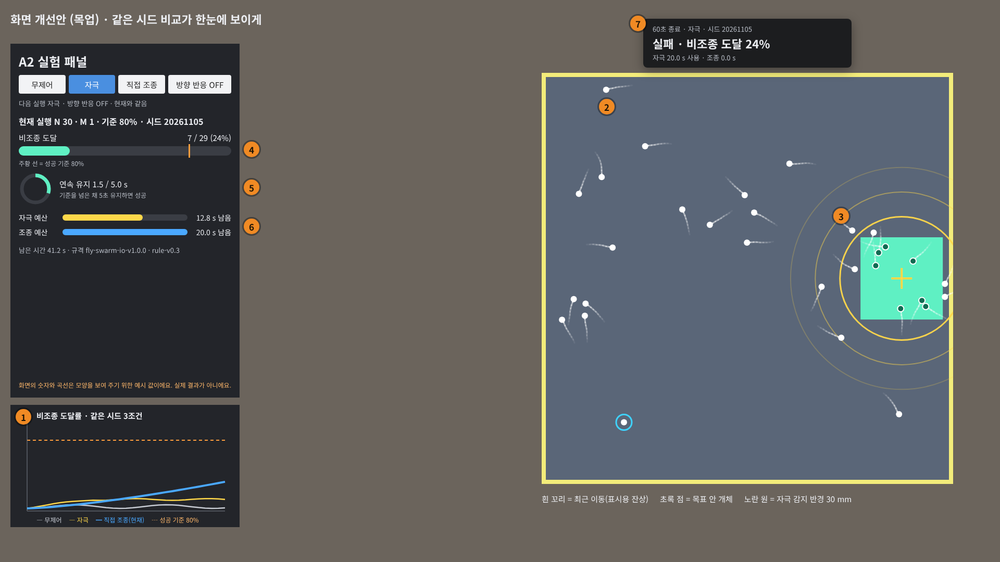

# 작업 기록 — A파트 (11/05 ~ 11/25)

> 내가 한 일만 날짜순으로 적었다. 위가 최신. PR 번호는 팀 저장소 기준.
> 문제 해결 과정은 [case-studies.md](case-studies.md)에 따로 정리했다.

## 11/25 — 기말 발표, 마무리

- 기말 발표에서 내 파트(슬라이드 3~5: 실험 공간, 조건 조작, 기록·성능)를 발표했다.
- **교수님 질문 두 가지**
  - Unity를 사용한 이유
  - PPO라는 용어 (보상을 이용한 강화학습)
- 발표 후 내 파트 개인 보고서를 팀에 공유하고, 이 폴더를 포트폴리오용으로 정리했다 (README 재구성, 한 장 요약, 시연 영상 공개본).

## 11/24 — 발표 준비 (발표 11/25)

- **화면 개선(도달률 막대·5초 타이머)은 발표에 넣지 않기로 팀 결정.** 구현 브랜치는 로컬에만 보관했다 ([케이스 10](case-studies.md#케이스-10-구현했지만-넣지-않기-1123-1124)).
- 팀장이 만든 발표자료 초안에서 내 파트(슬라이드 3~5)를 검토하고 수정할 내용을 정리해 전달 → 최종본에 반영.
  - 성능 표에 **측정 조건 표시**: 50마리는 rule-v0.2로만 쟀고, 30·100마리는 rule-v0.3 방향 반응 OFF·ON 모두 측정. 각주로 vSync 상한·조건별 1회·발표 PC 미측정 ([케이스 11](case-studies.md#케이스-11-발표-표에도-측정-조건을-1124))
  - 비교 화면 슬라이드에 실행 기록 캡처 + "시연 참고용, 공식 수치는 오프라인 평가" 한 줄
  - 발표 노트에 슬라이드마다 "어려웠던 점 → 해결" 한 줄
- 교수님 평가 기준(수업 기술 2가지 이상, 어려웠던 점, 역할·아쉬운 점)과 발표자료를 대조해 빠진 항목을 팀장에게 제안 → 반영.
- 내 파트 2분 30초 대본과 예상 질문 7개 정리. 흩어져 있던 프로젝트 파일(바탕화면·카톡·다운로드)을 작업 폴더 하나로 모으고 중복은 해시로 확인 후 정리.

## 11/23 — 시연 영상 v2, 화면 개선안 공유

- 팀원 피드백을 반영해 **A5 영상 v2**: 자극 장면 자막을 "목표 중앙 고정 자극 · 초기화 약 3초 뒤 수동으로 켬 · 규칙 기준선을 사람이 재현"으로 고쳐, 사람이 조작한 장면임을 분명히 했다. 팀 카톡에 공유.
- 11/22에 만든 화면 개선안(7개 + 개체 모양)을 팀에 공유 → 피드백으로 범위를 **비조종 도달률 막대(80% 기준선) + 5초 연속 유지 타이머** 두 가지로 좁힘. 목업의 타이머 표시 오류(기준 미달인데 시간이 차 있음)도 수정.
- 승인 전이라 별도 브랜치에서 두 기능을 미리 구현하고, 팀 버전 Unity로 컴파일·동작 확인.
- 팀장이 배포한 웹 데모(별도 FlyWire 회로 모델)를 직접 돌려 보고, 우리 Unity 화면과 같은 점(성공 기준 80%·5초)과 다른 점(행동 모델·자극 방식·시드)을 정리해 발표 용어 맞추기를 제안.

## 11/22 — A4 마감, 리뷰 반영, A5 시연 영상

- **비교 화면 2단계**: 제어 방식 버튼(무제어 / 자극 / 직접 조종)과 방향 반응 OFF/ON 버튼을 A2 패널에 추가. 버튼을 누르면 "다음 실행 … 초기화하면 적용"(노랑)으로 대기하고, 초기화하면 "현재와 같음"(회색)으로 바뀐다. C 담당이 준 API 패치는 내 코드와 섞지 않고 별도 커밋으로 적용했다.
- **자극 표시**: 자극 모드에서 자극 위치 `+`와 감지 반경 30 mm 원을 그린다. 켜지면 노랑, 꺼지면 회색. 값만 읽는 표시라 결과에 영향 없음. 자극을 켜도 "아무 일도 안 일어나는 것처럼 보이는" 문제를 화면으로 풀었다.
- **성능 측정 확장**: 측정 도구에 방향 반응 인자를 추가하고, 학교 PC에서 원격으로 N=30·100 × OFF·ON을 측정 → 4조건 모두 60 FPS · 50 steps/s.
- **PR #16** 생성 → 리뷰에서 실행 기록의 경계 사례 2건 지적 → 수정(`96e03a9`) 후 승인 ([케이스 8](case-studies.md#케이스-8-화면에-보인-값--마지막-값-1122))
- **A5 영상**: 수정 빌드로 장면 1~5를 처음부터 다시 촬영 → ffmpeg로 1080p 컷 편집, 4배속, 자막, 사용자 경로 가림 → 전체판 2:43 · 짧은 판 1:40 (공개본은 끝의 팀원 이름 화면을 빼서 2:37 · 1:35).
- **팀 결정 반영**: A4는 이날 범위로 마감. 실시간 규칙 제어·자극 위치 클릭은 범위 밖.
- 다음 날 회의용 **화면 개선안** 7개 + 개체 모양 후보 3개 준비 (아래 이미지).

## 11/21 — rule-v0.3 전환 PR 병합

- 내가 올린 PR #13(행동 규칙 rule-v0.3 전환, 방향 반응 기본 OFF)이 병합됐다.

## 11/19 — 후속 UI 병합, 성능 측정, 비교 화면 1단계

- **PR #12 병합**: 일시정지/재개, 실제 조종 표시(조종 후보 링이 실제 조종 중이면 주황).
- **PR #13**: A 씬의 행동 규칙을 rule-v0.3으로 교체. 씬 파일 2줄만 바뀌는 작은 PR로 분리.
- **성능 측정**: 명령줄 인자(`-a-perf`)일 때만 동작하는 측정 도구를 만들고 학교 PC에서 N=30·50·100 측정 → 모두 60 FPS(vSync 상한) · 초당 50스텝.
- **비교 화면 1단계**: 지표에 규격·행동 버전·시드·평가 대상 D(= N − M) 추가, 실행이 끝날 때마다 조건·결과를 한 줄씩 남기는 실행 기록 표.
- 다른 파트 PR의 질문(창 모드, 포커스를 잃으면 멈추는 문제)을 실제 빌드로 재현해 답했다.

## 11/17 — 집 PC 개발 환경

- 학교 PC와 같은 경로·같은 Unity 버전으로 집 PC를 구성하고 팀 저장소를 clone. 이후 학교 PC는 원격으로 측정·빌드에만 사용.

## 11/16 — 행동 규칙 연결, 경계값 점검

- B 파트의 행동 규칙 프로필을 A 씬에 연결(PR #6). 연결 전에는 개체가 멈춰 있고, 연결 후 움직이는 것을 같은 시드로 비교 확인.
- 경계값 점검: N=1, N=100, M=0, M=N(평가 대상 없음 → N/A), 조종 예산 20초 자동 종료.
- 일시정지 중 Reset, 같은 시드에서 "그냥 실행" vs "5초 멈췄다 재개"의 배치가 같은지 확인 → UI가 결과를 바꾸지 않음을 증명.

## 11/12 ~ 11/15 — A2 UI 빌드, PR 정리

- A2 실험 패널을 Windows 빌드로 확인: 한글 폰트, 1920×1080 배치, 키 입력, 조종 후보 링.
- PR #1이 squash 병합되면서 PR #2에 94개 파일이 보이는 문제 → main을 merge 커밋으로 반영해 정리(강제 push 없이).
- C 파트 후속 PR(일시정지·실제 조종 상태 API)을 내 PC에서 재현해 승인 리뷰.
- 11/15 PR #2(A2 기본 UI) 병합.

## 11/10 — A1 완료, 팀 저장소 이관, A2 UI

- A1(공간·목표·카메라) 완료 기준을 하나씩 확인하고 Done. 목표 안에서 시작하는 개체가 없는지 N=30·100으로 확인.
- 공유 빌드 설정을 건드리지 않도록 **A 전용 빌드 프로필**을 만들어 첫 빌드(오류 0).
- C 담당과 파일 소유권·전달 규칙을 합의하고, 로컬 통합본을 5개 커밋으로 기록 → 이게 팀 저장소의 출발점(PR #1, 83개 파일)이 됐다.
- A2 실험 패널 설계 → 코드 전에 C 담당에게 읽을 값·쓸 값을 물어 접점 확정 → 구현(PR #2). 설계 점검 중 UI 키와 조종 키 충돌을 발견해 미리 막았다.

## 11/09 — C 수동 제어 적용

- C 파트의 수동 제어 모듈을 A 씬 사본에 적용하고 동작 확인.

## 11/06 — 기준선, A_Main 씬

- 받은 C1 프로젝트를 **수정 없이** 먼저 실행해 기준선을 남겼다.
- 그 씬을 복사해 A_Main을 만들고, 200×200 mm 경기장·목표·mm 표시(ASpaceView)를 붙였다. 표시 스크립트는 실행기 값을 읽기만 한다.

## 11/05 — 첫날: 기준 세우기

- 기획서·공통 규격·받은 파일 내용이 서로 달라서, **정보 우선순위**(공통 규격 > 기획서 > 대화)부터 정했다.
- 현황(status) · 인터페이스 계약(contract) · 검증 절차(verification) 문서 3종을 만들고, 받은 파일은 SHA-256으로 확인.
- Unity 설치, 작업 폴더 구조(받은 원본 / 기준 / 기록 / 빌드 / 팀 저장소) 설계.
