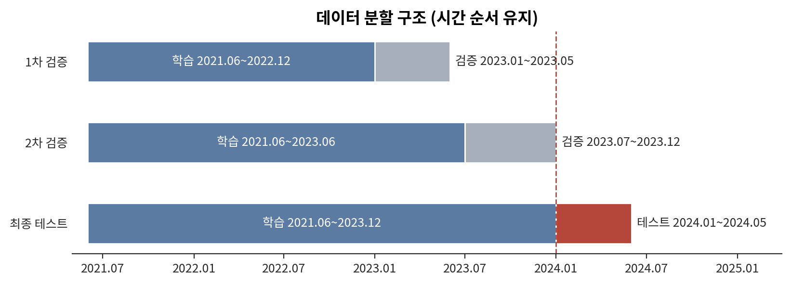
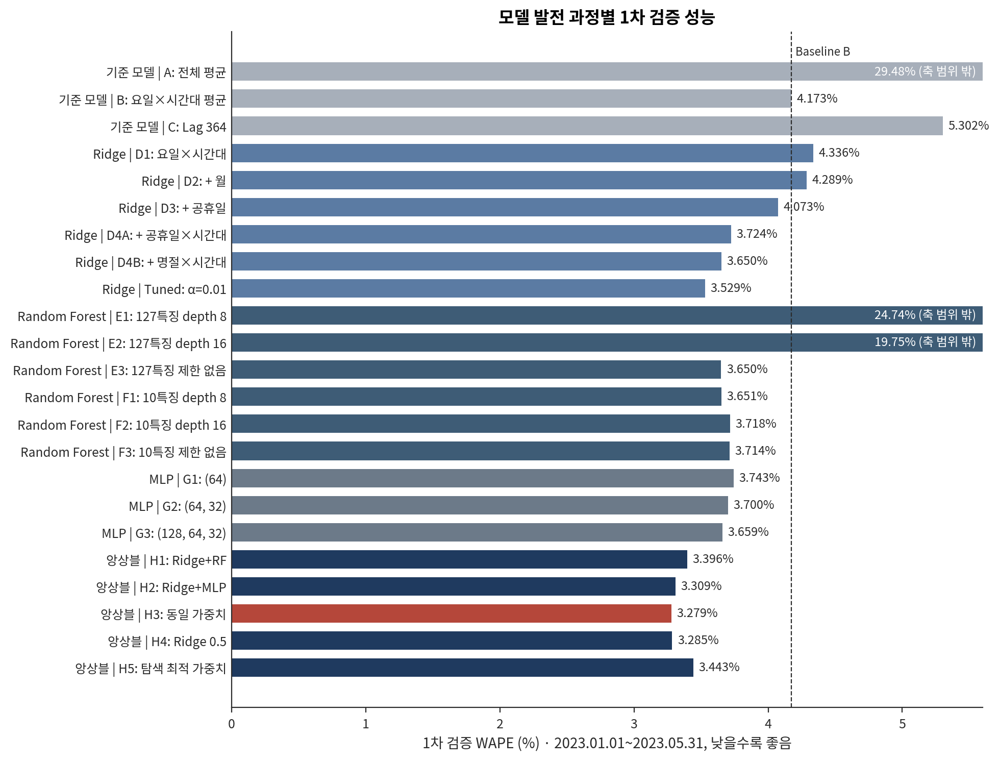
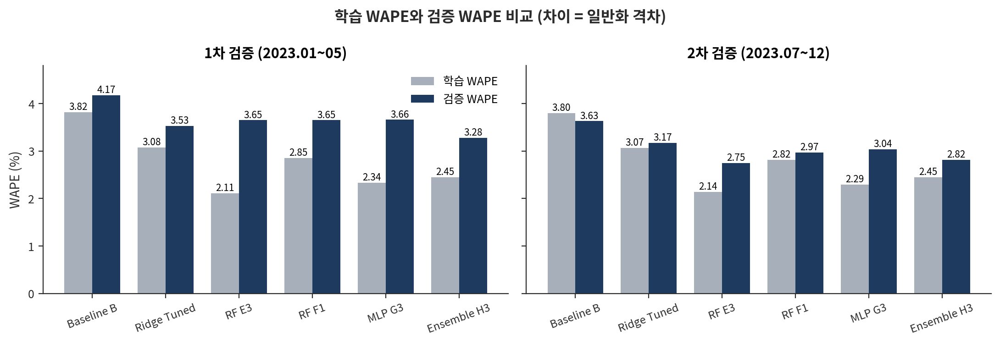

# 격자 인구 5개월 예측과 데이터 드리프트 분석

> 인공지능학습데이터전처리 기말과제 · 개인 · 2026학년도 2학기
> 보고서 제목: 시간적·공간적 특성 기반 인구 예측 모델 구축 및 데이터 드리프트 분석

> **데이터 공개 범위**
> - 이 과제의 데이터는 담당 교수님이 구입하신 유료 라이선스 자료라서, 원본 데이터, 데이터에서 나온 값·지도·그래프, 보고서, 코드는 올리지 않았다.
> - 이 폴더에 있는 수치는 모두 **내 모델의 오차율**이고, 그림은 데이터 분할 일정과 모델 성능뿐이다.

## 한눈에 보기

| | |
|---|---|
| 무엇 | 과거 데이터만으로 다음 5개월의 **전체 인구 합계**와 **격자별 분포**를 한 번에 예측하는 모델 |
| 결과 | 검증에서는 기준 모델보다 오차가 21.93% 작았지만, 실제 테스트에서는 기준 모델을 넘지 못했다 |
| 핵심 | 테스트에서 틀린 이유를 데이터로 분석했다. 전체 규모와 공간 분포는 바뀌었고, 하루 중 시간대 패턴은 유지됐다 |
| 도구 | Python · NumPy · pandas · scikit-learn(Ridge, Random Forest, MLP) · Matplotlib · Claude · ChatGPT |

## 왜 어려운 문제였나

예측 기간의 실제값을 하나도 보지 않고 5개월 뒤까지 맞혀야 했다. 예측에 쓸 수 있는 정보는 달력(요일, 시간대, 공휴일)과 과거 패턴뿐이다. 그래서 "검증에서 잘 맞는 모델"과 "실제 미래에서도 맞는 모델"이 다를 수 있다는 점을 처음부터 염두에 두고 평가 방식을 설계했다.

## 내가 내린 판단

| 판단 | 이유 |
|---|---|
| 시간 순서를 지키는 검증 | 미래 데이터가 학습에 섞이면 성능이 부풀려진다. 과거로 학습하고 그 뒤 기간으로 평가하는 검증을 서로 다른 두 기간에서 했다 |
| 기준 모델부터 만들기 | "요일×시간대 평균" 같은 단순한 기준이 있어야, 복잡한 모델이 정말 나아졌는지 판단할 수 있다 |
| 예측 시점에 알 수 있던 공휴일만 사용 | 임시공휴일처럼 예측 시점 이후에 정해진 휴일은 법령 개정·지정 날짜까지 확인해 입력에서 뺐다 |
| 단계적으로 모델 발전 | Ridge(특성 추가) → Random Forest(특성 표현 비교) → MLP(구조·학습 횟수) → 세 모델의 동일 가중 앙상블. 앞 단계의 약점을 다음 단계에서 보완했다 |
| Top-down 공간 예측 | 수천 개 격자를 하나씩 예측하지 않고, 전체 합계를 예측한 뒤 과거 공간 비율로 나눴다. 격자 합계와 전체 예측이 항상 맞는다 |
| 테스트 전에 예측 파일 봉인 | 예측 파일을 저장하고 SHA-256 해시를 기록한 다음에 테스트 실제값을 열었다. 결과를 보고 예측을 고치지 않았다는 증거다 |

## 결과

수치는 모두 모델의 오차율(WAPE, 낮을수록 좋음)이다.

| 모델 | 두 검증 기간 통합 WAPE |
|---|---|
| 기준 모델 (요일×시간대 평균) | 3.87431% |
| **최종 모델 (Ridge·RF·MLP 동일 가중 앙상블)** | **3.02450%** |

공간 예측도 공간 기준 모델보다 오차가 2.46% 작았다.

**최종 테스트에서는 기준 모델을 넘지 못했다.**

| 모델 | 테스트 WAPE | 공간 테스트 WAPE |
|---|---|---|
| 기준 모델 | 34.88758% | 85.06139% |
| 최종 모델 | 35.08887% | 85.24124% |

최종 모델은 테스트 기간의 모든 시점에서 실제보다 높게 예측했다.

## 왜 틀렸나: 데이터가 바뀌었다

결과를 숨기지 않고 원인을 분석했다.

- **규모:** 테스트 기간이 시작되는 시점을 경계로 데이터의 전체 규모가 계단처럼 크게 낮아졌다.
- **공간 분포:** 격자별 분포도 직전 연도들 사이의 변화보다 훨씬 크게 달라졌다.
- **시간대 패턴:** 하루 중 시간대별 상대 패턴은 거의 그대로 유지됐다.

즉 모델이 배운 "하루의 리듬"은 맞았지만, 규모와 분포가 바뀌어서 과거 수준에 맞춘 예측이 계속 높게 나왔다.

- **사후 진단:** 진단용으로 월별 규모만 실제에 맞춰 보면 오차가 학습 기간 수준으로 크게 줄었다. 이건 원인을 확인하는 사후 진단이지 예측 성능이 아니어서, 공식 결과와 끝까지 구분해 적었다.
- **남은 한계:** 규모가 왜 바뀌었는지(실제 인구 변화인지, 수집·집계 방식 변화인지)는 확인하지 못해 한계로 남겼다.

## 배운 것

1. **검증 점수가 미래를 보장하지 않는다.** 데이터 분포가 바뀌면(데이터 드리프트) 검증 결과는 이어지지 않는다. 실제 서비스라면 드리프트 감지와 재학습 절차가 같이 있어야 한다.
2. **누수는 생각보다 미묘하다.** 테스트 데이터는 철저히 막았지만, 초기 탐색(EDA)에 검증 기간 데이터가 들어가 특성 설계에 간접적으로 영향을 줬을 가능성을 나중에 찾았다. 보고서에 한계로 적었고, 다음에는 탐색 단계부터 기간을 나누려 한다.
3. **실패한 결과도 정직하게 쓴다.** 성능을 맞추려고 예측값을 보정하지 않았다.

## 현장과의 연결

편집샵에서 일하며 반복되는 매장 운영의 비효율을 겪은 것이 AI를 공부하게 된 계기였다. 이 과제는 "언제, 어디에 사람이 몰리는가"라는 현장의 질문을 데이터로 다뤄 본 경험이다.

- **매장 운영에 쓰면:** 요일×시간대 패턴은 인력 배치에, 공휴일 처리는 시즌 운영에 이어진다.
- **규모가 갑자기 바뀌면:** 상권 변화나 리뉴얼처럼 규모가 갑자기 바뀌는 상황에서는 "패턴은 유지하고 규모는 다시 맞추는" 전략이 필요하다는 것도 확인했다.

## AI 도구를 쓴 방식

- **쓴 범위:** ChatGPT와 Claude를 연구 계획 논의, 코드 작성 보조와 디버깅, 모델 설계 검토, 결과 해석 논의, 보고서 문장 작성·수정, 독립 교차 검토에 썼다.
- **최종 판단:** 데이터 분할 기준, 모델 선정, 결과 해석은 실행 결과를 직접 확인하고 결정했다.
- **교차 검토:** 두 도구의 교차 검토를 여러 번 거쳤고, 지적은 코드와 결과 파일에 대조해서 받아들일지 정했다.
